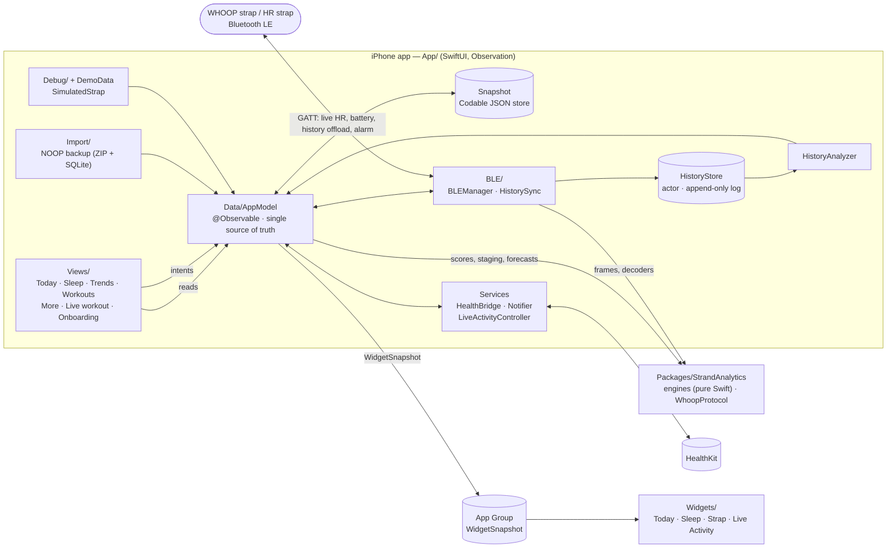

# Personal Whoop (iOS)

An on-device SwiftUI app that turns the heart-rate and sleep data from your own WHOOP strap (or any standard Bluetooth
HR strap) into Charge, Effort, Rest, stress, sleep staging, workouts and trends. Nothing leaves the phone: all scoring runs
locally and is an **approximation, not a medical device and not WHOOP's scoring**.

Without a strap the app runs on synthetic demo data (a first-run choice, switchable later in Settings). All screenshots
below were taken in demo mode.

  
  
  

  
  

  

## Features

- **Today** – Charge (with HRV, resting HR and respiration drivers), Effort, Rest, live heart rate, heart rate through the
  day, stress by hour, hydration, tomorrow's Charge forecast, readiness signals and illness heads-up. You choose which cards
  show, their order, and which values appear on the Charge card (Settings → Personalize).
- **Sleep** – last night's hypnogram, Rest score, heart rate during sleep, sleep need and debt. *Tonight* has "going to bed /
  I woke up" marks and the morning alarm: a live countdown to the next ring, a different time per weekday, a one-time change
  for just the next morning, and a snooze that keeps ringing even if you silenced the first buzz.
- **Trends** – 7/14/30/60-day charts (the range you pick is remembered), plus Fitness · Fatigue · Form and a weekly digest.
- **Workouts** – start a tracked workout (Live Activity on the lock screen and Dynamic Island), interval timer, workouts detected
  from heart rate and motion, activity heat map, history.
- **Strap** – live heart rate, battery with an estimate of hours until 0 %, history sync (resumable, with progress and ETA).
- **More** – Breathe and HRV tools, Vitality and Fitness Age, body clock and jet lag, cycle awareness, Apple Health, NOOP backup
  import, widgets (home screen and lock screen).

## Architecture

Three parts: a native iOS app, a WidgetKit extension (home screen, lock screen, Live Activity), and a pure-Swift analytics
package (`StrandAnalytics`) that holds all scoring and the WHOOP protocol.

| Path | Purpose |
|---|---|
| `App/` | iOS client (iOS 17+) |
| `App/Views/` | SwiftUI screens and shared components (`Card`, `Ring`, `HeartRateChart`, …) |
| `App/Data/AppModel.swift` | Observable model: loads and saves the snapshot, runs `recompute()`, owns alarm and snooze logic |
| `App/Data/Models.swift` | Codable value types: `Snapshot`, `DailyMetric`, `AppSettings`, `UISettings`, `AlarmSettings` |
| `App/BLE/` | `BLEManager` (CoreBluetooth central), `HistorySync` (resumable strap offload) |
| `App/Data/HistoryStore.swift`, `HistoryAnalyzer.swift` | Append-only record log and its analysis into nights, days and raw streams |
| `App/Data/HealthBridge.swift`, `Notifier.swift`, `LiveActivityController.swift` | System integrations: HealthKit, notifications, ActivityKit |
| `App/Data/Import/` | `.noopbak` importer: streaming ZIP and SQLite readers, no third-party code |
| `App/Debug/`, `App/Data/DemoData.swift` | Demo data, `SimulatedStrap` and the screenshot exporter |
| `Widgets/`, `Shared/` | Widget extension and the snapshot and views it shares with the app |
| `Packages/StrandAnalytics/` | Analytics engines and `WhoopProtocol` as a Swift package, with unit tests (`swift test`) |

### Design patterns

- **Single observable model, one-way data flow.** Views read `AppModel` from the environment and call its methods; they never
  touch BLE, storage or HealthKit. Data comes in (strap, history, Health, import), `AppModel` updates the `Snapshot` and calls
  `recompute()`, and views re-render. Uses `@Observable`, not `ObservableObject`.
- **Pure analytics core.** Scoring, staging and forecasting are stateless functions over plain values in `StrandAnalytics`:
  no UI, no file or settings I/O, and the current time is passed in. They are deterministic and unit-tested; the app target is a
  thin integration layer.
- **Protocol separate from transport.** `WhoopProtocol` knows frames, CRCs and decoders only. `BLEManager` owns the
  CoreBluetooth session and reports through closures (`onHR`, `onBattery`) that `AppModel` subscribes to.
- **Durable, resumable sync.** `HistorySync` saves every chunk into `HistoryStore` before acknowledging it to the strap, so an
  interrupted sync loses nothing and resumes. `HistoryStore` is an actor, which keeps decoding a large first sync off the main
  thread.
- **Demo and real data are interchangeable sources.** `DemoData` and `SimulatedStrap` produce the same shapes as the real
  strap, so every screen works without hardware. The two are never mixed; switching asks for confirmation.
- **Tolerant, additive persistence.** State is one JSON `Snapshot`. New fields are optional or decoded with `decodeIfPresent`
  (see `UISettings`) so saves from older builds keep loading, and an unreadable save is copied aside before anything can
  overwrite it.
- **Data-driven personalisation.** Today's cards are an enum (`TodayCard`); `UISettings` stores order and hidden cards and
  values. Adding a card is one enum case plus one `switch` arm.
- **Extensions get a small snapshot, not the model.** The app writes a compact `WidgetSnapshot` into the App Group; widgets
  and the Live Activity render from it and never link `AppModel`.
- **Alarm as a scheduler over one hardware slot.** The strap holds a single absolute alarm, so `AppModel` works out the next
  wake (weekly schedule plus an optional one-off override), arms the strap and a backup phone notification, and queues the snooze
  rings as notifications up front so they survive the app being suspended.

The same page lives in [docs/ARCHITECTURE.md](docs/ARCHITECTURE.md).

## Build and run

1. Install [XcodeGen](https://github.com/yonaskolb/XcodeGen), then `xcodegen generate` and open `PersonalWhoop.xcodeproj`
   (iOS 17+).
2. Run the analytics tests: `cd Packages/StrandAnalytics && swift test`.
3. On a real device, enable **App Groups**, **HealthKit** and (for the Live Activity) the capabilities under your own signing
   team, and change the group id `group.com.octa.personalwhoop` if needed.

A fresh install asks whether to use demo data or connect a strap (Settings → Profile & units → Data source switches later).

## More details

### Widgets
`Widgets/` is a WidgetKit extension (home screen small/medium/large, lock screen circular/rectangular/inline). The app writes a
small snapshot (`Shared/WidgetShared.swift`) into the App Group `group.com.octa.personalwhoop`.

### Apple Health and Live Activities
- Settings → Apple Health reads steps, resting HR, respiratory rate, sleep, workouts and active energy (fills gaps; steps
  replace the strap's estimate) and can write workouts (with HR samples), sleep stages and water back. HRV is intentionally
  not imported (SDNN vs RMSSD).
- A tracked workout shows on the lock screen and in the Dynamic Island (heart rate, zone, timer, kcal, effort).

### Importing a NOOP backup
Settings → Import from another app reads a `.noopbak` (a ZIP holding `noop-backup.sqlite`, `settings.json`, `manifest.json`):
strap-derived days, sleep nights with stages, workouts (last year) and Apple Health history (gap filler). The ZIP is streamed and
inflated on-device; the SQLite copy is opened read/write because backups are WAL-mode.

### Strap history sync
`App/BLE/HistorySync.swift` implements the offload from the protocol notes: SEND_HISTORICAL_DATA, chunks of type-47 records, each
chunk saved (`HistoryStore`) *before* it is acknowledged with command 23, with progress, ETA and auto-resume after drops.
`HistoryAnalyzer` turns stored records into sleep nights, daily rows and today's raw streams.

### Appearance
Settings → Personalize: Automatic (follow iPhone), Light, Dark, or light/dark by time of day.

### Not covered yet
WHOOP history decoding beyond the frame layer for 5/MG record versions 20/21/26, ECG, Oura/Polar/Xiaomi sources and the AI coach.
Strap alarm arming is wired for WHOOP 4.0 only (5/MG is experimental).
