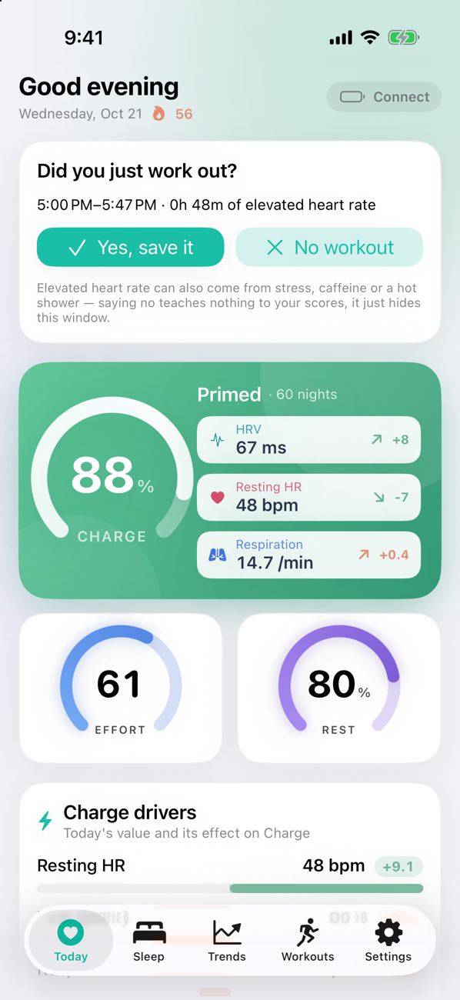
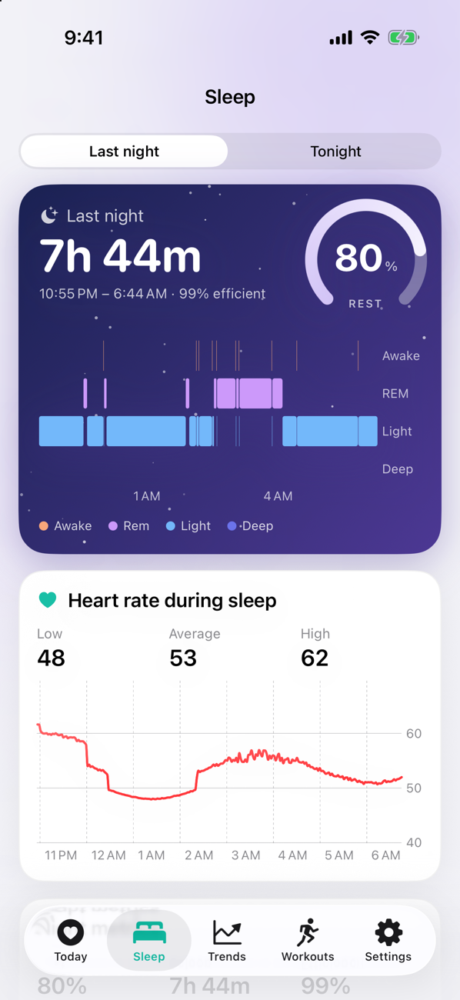
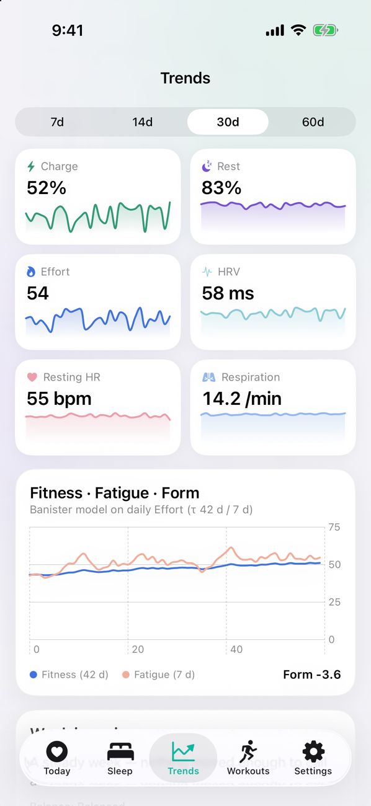
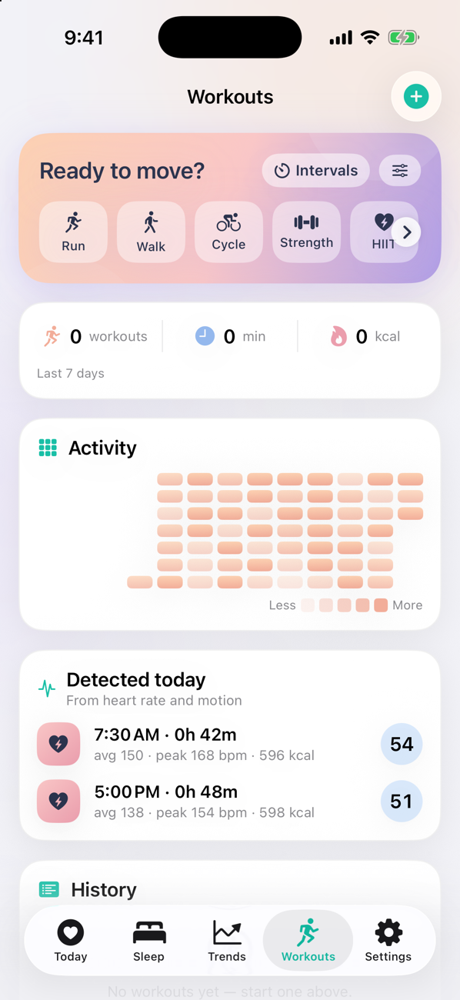
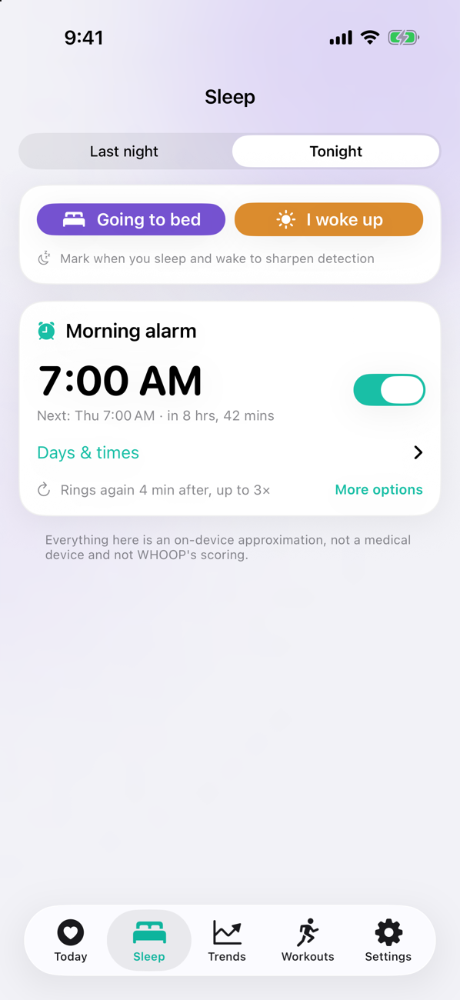
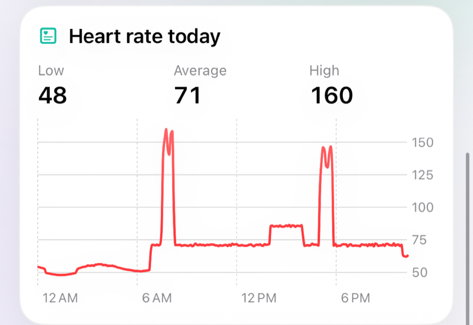

# Personal Whoop (iOS)

An on-device SwiftUI app that turns the heart-rate and sleep data from your own WHOOP strap (or any standard Bluetooth
HR strap) into Charge, Effort, Rest, stress, sleep staging, workouts and trends. Nothing leaves the phone: all scoring runs
locally and is an **approximation, not a medical device and not WHOOP's scoring**.

Without a strap the app runs on synthetic demo data (a first-run choice, switchable later in Settings). All screenshots
below were taken in demo mode.

  
  
  

  
  

  

## Features

- **Today** – Charge (with HRV, resting HR and respiration drivers), Effort, Rest, live heart rate, heart rate through the
  day, stress by hour, hydration, tomorrow's Charge forecast, readiness signals and illness heads-up. You choose which cards
  show, their order, and which values appear on the Charge card (Settings → Personalize).
- **Sleep** – last night's hypnogram, Rest score, heart rate during sleep, sleep need and debt. *Tonight* has "going to bed /
  I woke up" marks and the morning alarm: a live countdown to the next ring, a different time per weekday, a one-time change
  for just the next morning, and a snooze that keeps ringing even if you silenced the first buzz.
- **Trends** – 7/14/30/60-day charts (the range you pick is remembered), plus Fitness · Fatigue · Form and a weekly digest.
- **Workouts** – start a tracked workout (Live Activity on the lock screen and Dynamic Island), interval timer, workouts detected
  from heart rate and motion, activity heat map, history.
- **Strap** – live heart rate, battery with an estimate of hours until 0 %, history sync (resumable, with progress and ETA).
- **More** – Breathe and HRV tools, Vitality and Fitness Age, body clock and jet lag, cycle awareness, Apple Health, NOOP backup
  import, widgets (home screen and lock screen).

## Architecture

SwiftUI views read one observable `AppModel`; it talks to the strap (`BLEManager`, `HistorySync`), storage, HealthKit and the
widgets, and calls a pure-Swift analytics package (`StrandAnalytics`) for every score. The full diagram, folder map and the
design patterns are in **[docs/ARCHITECTURE.md](docs/ARCHITECTURE.md)**.

## Build and run

1. Install [XcodeGen](https://github.com/yonaskolb/XcodeGen), then `xcodegen generate` and open `PersonalWhoop.xcodeproj`
   (iOS 17+).
2. Run the analytics tests: `cd Packages/StrandAnalytics && swift test`.
3. On a real device, enable **App Groups**, **HealthKit** and (for the Live Activity) the capabilities under your own signing
   team, and change the group id `group.com.octa.personalwhoop` if needed.

A fresh install asks whether to use demo data or connect a strap (Settings → Profile & units → Data source switches later).

## More details

### Widgets
`Widgets/` is a WidgetKit extension (home screen small/medium/large, lock screen circular/rectangular/inline). The app writes a
small snapshot (`Shared/WidgetShared.swift`) into the App Group `group.com.octa.personalwhoop`.

### Apple Health and Live Activities
- Settings → Apple Health reads steps, resting HR, respiratory rate, sleep, workouts and active energy (fills gaps; steps
  replace the strap's estimate) and can write workouts (with HR samples), sleep stages and water back. HRV is intentionally
  not imported (SDNN vs RMSSD).
- A tracked workout shows on the lock screen and in the Dynamic Island (heart rate, zone, timer, kcal, effort).

### Importing a NOOP backup
Settings → Import from another app reads a `.noopbak` (a ZIP holding `noop-backup.sqlite`, `settings.json`, `manifest.json`):
strap-derived days, sleep nights with stages, workouts (last year) and Apple Health history (gap filler). The ZIP is streamed and
inflated on-device; the SQLite copy is opened read/write because backups are WAL-mode.

### Strap history sync
`App/BLE/HistorySync.swift` implements the offload from the protocol notes: SEND_HISTORICAL_DATA, chunks of type-47 records, each
chunk saved (`HistoryStore`) *before* it is acknowledged with command 23, with progress, ETA and auto-resume after drops.
`HistoryAnalyzer` turns stored records into sleep nights, daily rows and today's raw streams.

### Appearance
Settings → Personalize: Automatic (follow iPhone), Light, Dark, or light/dark by time of day.

### Not covered yet
WHOOP history decoding beyond the frame layer for 5/MG record versions 20/21/26, ECG, Oura/Polar/Xiaomi sources and the AI coach.
Strap alarm arming is wired for WHOOP 4.0 only (5/MG is experimental).
