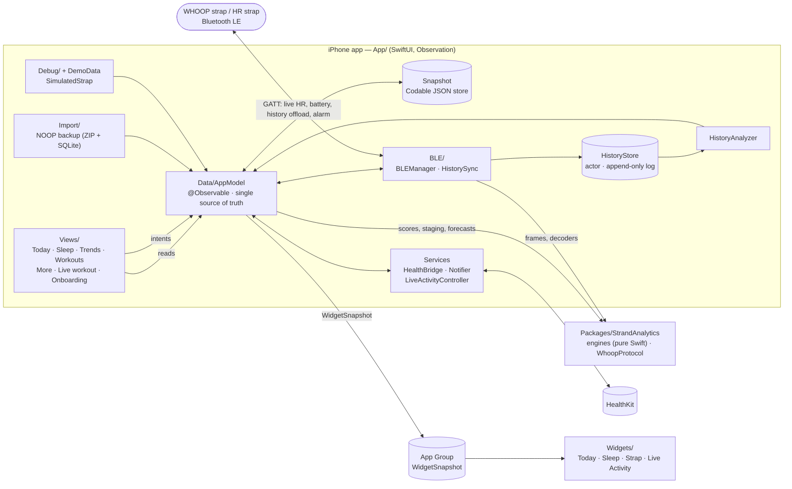

# Architecture

Three parts: a native iOS app, a WidgetKit extension (home screen, lock screen, Live Activity), and a pure-Swift analytics
package (`StrandAnalytics`) that holds all scoring and the WHOOP protocol.

| Path | Purpose |
|---|---|
| `App/` | iOS client (iOS 17+) |
| `App/Views/` | SwiftUI screens and shared components (`Card`, `Ring`, `HeartRateChart`, …) |
| `App/Data/AppModel.swift` | Observable model: loads and saves the snapshot, runs `recompute()`, owns alarm and snooze logic |
| `App/Data/Models.swift` | Codable value types: `Snapshot`, `DailyMetric`, `AppSettings`, `UISettings`, `AlarmSettings` |
| `App/BLE/` | `BLEManager` (CoreBluetooth central), `HistorySync` (resumable strap offload) |
| `App/Data/HistoryStore.swift`, `HistoryAnalyzer.swift` | Append-only record log and its analysis into nights, days and raw streams |
| `App/Data/HealthBridge.swift`, `Notifier.swift`, `LiveActivityController.swift` | System integrations: HealthKit, notifications, ActivityKit |
| `App/Data/Import/` | `.noopbak` importer: streaming ZIP and SQLite readers, no third-party code |
| `App/Debug/`, `App/Data/DemoData.swift` | Demo data, `SimulatedStrap` and the screenshot exporter |
| `Widgets/`, `Shared/` | Widget extension and the snapshot and views it shares with the app |
| `Packages/StrandAnalytics/` | Analytics engines and `WhoopProtocol` as a Swift package, with unit tests (`swift test`) |

## Design patterns

- **Single observable model, one-way data flow.** Views read `AppModel` from the environment and call its methods; they never
  touch BLE, storage or HealthKit. Data comes in (strap, history, Health, import), `AppModel` updates the `Snapshot` and calls
  `recompute()`, and views re-render. Uses `@Observable`, not `ObservableObject`.
- **Pure analytics core.** Scoring, staging and forecasting are stateless functions over plain values in `StrandAnalytics`:
  no UI, no file or settings I/O, and the current time is passed in. They are deterministic and unit-tested; the app target is a
  thin integration layer.
- **Protocol separate from transport.** `WhoopProtocol` knows frames, CRCs and decoders only. `BLEManager` owns the
  CoreBluetooth session and reports through closures (`onHR`, `onBattery`) that `AppModel` subscribes to.
- **Durable, resumable sync.** `HistorySync` saves every chunk into `HistoryStore` before acknowledging it to the strap, so an
  interrupted sync loses nothing and resumes. `HistoryStore` is an actor, which keeps decoding a large first sync off the main
  thread.
- **Demo and real data are interchangeable sources.** `DemoData` and `SimulatedStrap` produce the same shapes as the real
  strap, so every screen works without hardware. The two are never mixed; switching asks for confirmation.
- **Tolerant, additive persistence.** State is one JSON `Snapshot`. New fields are optional or decoded with `decodeIfPresent`
  (see `UISettings`) so saves from older builds keep loading, and an unreadable save is copied aside before anything can
  overwrite it.
- **Data-driven personalisation.** Today's cards are an enum (`TodayCard`); `UISettings` stores order and hidden cards and
  values. Adding a card is one enum case plus one `switch` arm.
- **Extensions get a small snapshot, not the model.** The app writes a compact `WidgetSnapshot` into the App Group; widgets
  and the Live Activity render from it and never link `AppModel`.
- **Alarm as a scheduler over one hardware slot.** The strap holds a single absolute alarm, so `AppModel` works out the next
  wake (weekly schedule plus an optional one-off override), arms the strap and a backup phone notification, and queues the snooze
  rings as notifications up front so they survive the app being suspended.
